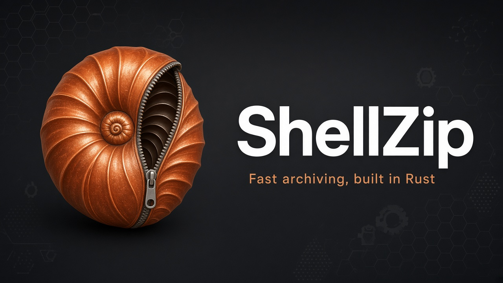

<p align="center">
  
  <br>
  <a href="https://github.com/menonsoftware/ShellZip/releases/latest"></a>
</p>

# ShellZip

ShellZip is a Rust archive manager: a desktop window (`shellzip`), a command-line tool (`szip`), and a small self-extracting stub (`shellzip-sfx`). One library crate, `shellzip-core`, does the archive work. The front ends stay thin.

It packs and unpacks ZIP, 7z, tar, gzip, and zstd, extracts xz, bzip2, and RAR, and never creates a RAR archive. Detection uses magic bytes, not the file extension. Entry names are checked before anything is written to disk.

Licensed under MIT. Not published to crates.io.

## Windows Defender and SmartScreen

App signing is still pending, so release builds ship **without Authenticode**. SmartScreen treats that as an unknown publisher. Microsoft Defender can also score the binary as a trojan from heuristics that match shapes ShellZip really uses:

- **Unsigned, stripped release PEs** — workspace release profile uses LTO, one codegen unit, and `strip`; CI leaves the Velopack pack unsigned until Certum secrets are set ([docs/BUILDING.md](docs/BUILDING.md))
- **Self-extracting stub** — `shellzip-sfx` is a small windowed PE with an appended archive and an `SZSFX01` trailer; it reads its own image and writes the payload (including `.exe` members)
- **Explorer shell DLL** — `shellzip_shell.dll` is an in-proc `IContextMenu`; `--integrate` copies it under `%LOCALAPPDATA%\ShellZip`, registers the COM server, and the menu starts `shellzip.exe`
- **Velopack updates** — an installed build can download a newer package from GitHub Releases, restart, and re-run `--integrate`

ShellZip does not inject into other processes, write Run / AppInit / IFEO keys, or shell out to `cmd` or PowerShell. The only optional network path is the GitHub update check. Until signing is live, allow the file in Defender or prefer a local `cargo` / `make release` build you trust.

## Features

- **Create** ZIP, 7z, `.tar`, `.tar.gz`, `.tar.zst`, `.gz`, and `.zst`
- **Extract, list, and test** those formats plus xz, bzip2, RAR 4/5, and ShellZip SFX packages
- **ZIP AES-256** (WinZip AE-2) for file contents; names stay visible
- **7z AES-256**, optional header encryption (`--hp`), solid or non-solid blocks
- **Update, freshen, delete, and rename** inside ZIP and 7z
- **Self-extractors** (`szip a --sfx` or `szip s`): stub + ZIP or 7z payload + 24-byte trailer. Windows cannot start a package of 4 GiB or larger
- **Desktop manager** with explorer, add/extract dialogs, test, view, info, reports, and themes
- **File associations and shell menus** on Windows, macOS, and Linux (`shellzip --integrate`)
- **WinRAR-style switches** on the CLI (`-p`, `-mt`, `-sfx`, `-hp`, `-si`, …)
- **Zip-slip and zip-bomb limits**, optional Mark of the Web on Windows (`--om`)

RAR creation is out of scope. The UnRAR licence forbids rebuilding the RAR compressor.

## Format support

| Format | Create | Extract / list / test | Password |
|---|---|---|---|
| ZIP | yes (Deflate, Zstd, Stored) | yes | AES-256, contents only |
| 7z | yes (LZMA2 default) | yes | AES-256; `--hp` hides names |
| TAR, TAR.GZ, TAR.ZST | yes | yes | no |
| GZ, ZST | yes | yes | no |
| TAR.XZ, TAR.BZ2, XZ, BZ2 | no | yes | no |
| RAR 4 / RAR 5 | **never** | yes | yes |
| SFX (ZIP or 7z payload) | yes | yes | same as the payload |

Opening an archive sniffs the bytes. A `.zip` that is actually RAR 5 is treated as RAR 5.

See [docs/FORMATS.md](docs/FORMATS.md) for methods, encryption, and safety limits.

## Build and run

You need a recent stable Rust (workspace `rust-version` is **1.88**, edition 2024). On Linux the desktop app also needs the GTK / X11 / Wayland packages listed in [docs/BUILDING.md](docs/BUILDING.md).

```bash
# Debug workspace
make

# Release CLI, GUI, and size-optimized SFX stub
make release

# Command line
make run ARGS="l archive.zip"
szip a out.zip src
szip x archive.zip -o dest --yes

# Desktop window (optional path opens that archive)
make gui
shellzip archive.zip
```

`make release` writes `szip`, `shellzip`, and `shellzip-sfx` under `target/release`. On Windows it also builds `shellzip_shell.dll`. `make explore` opens that folder.

Tagged GitHub releases ship that portable archive and a Velopack package: a Windows Setup, a Linux AppImage, and a macOS `.app`.

```bash
make install        # cargo install szip
make install-gui    # cargo install shellzip
make install-shell  # install-gui + register associations and menus
```

`shellzip --integrate` (also **Options → Integrate with the file manager**) registers per-user handlers, format icons from `grx/shellzip_file_icons`, and Open, Add, and Extract context-menu verbs.

## Command line

```text
szip <command> [options] <archive> [files…]
```

| Command | Action |
|---|---|
| `a` | Add files. An existing ZIP is updated unless `-y` replaces it |
| `u` / `f` | Update or freshen (ZIP and 7z) |
| `d` | Delete ZIP or 7z members that match a mask |
| `x` / `e` | Extract (keep paths / flatten) |
| `l` / `lt` | List / technical list (`--htb` adds BLAKE2sp) |
| `p` | Print one member to stdout |
| `t` | Test checksums and sizes |
| `s` | Wrap a ZIP or 7z as SFX, or unwrap an SFX back to that payload |
| `complete` | Write a shell completion script to stdout |

```bash
szip a backup.zip docs photos -m5 --threads 8
szip a secret.7z ledger --password --hp
szip x backup.zip -o restore --yes
szip lt backup.zip --htb
szip a payload.exe src --sfx --sfx-format zip
szip complete bash > szip.bash
```

Password sources, in order: `--password=SECRET`, bare `--password` (prompt, no echo), then `SZIP_PASSWORD`. The value is never written to the log or a window title.

Full switch list: [docs/CLI.md](docs/CLI.md).

## Desktop app

`shellzip` is an eframe window: folder tree, file list, address bar, and a toolbar for Open, Add, Extract To, Test, View, Delete, SFX, Info, and About.

- Drag a folder onto the window to pack it, or drop an archive to open it
- Add and Extract dialogs cover format, compression, update mode, passwords, and overwrite
- The status bar keeps the result and the elapsed time after a job finishes
- Light / dark / system theme, toolbar size, recent archives, and settings in a TOML file
- Generate an HTML, Markdown, or text listing from **Commands → Generate report**
- **Options → Check for updates…** looks for a newer Velopack package on GitHub Releases. A `cargo` build or an unzipped portable archive cannot update this way

User guide: [docs/GUI.md](docs/GUI.md).

## Crates

```
crates/shellzip-core        library: detect, pack, unpack, SFX trailer, safe paths
crates/shellzip-cli         binary `szip`
crates/shellzip-gui         binary `shellzip`
crates/shellzip-sfx         self-extractor stub (minisize profile)
crates/shellzip-integrate   associations, MIME tables, menu helpers
crates/shellzip-shell       Windows Explorer context-menu DLL
xtask                       developer tasks (`bench`, `gen-file-icons`)
```

`szip` and `shellzip` enable `rar`, `sevenz-codecs`, and `sevenz-parallel`. The SFX stub links only `sevenz` (LZMA2 and AES) so it stays small.

## Documentation

| Page | Contents |
|---|---|
| [docs/FAQ.md](docs/FAQ.md) | Common questions |
| [docs/CLI.md](docs/CLI.md) | `szip` reference, switches, exit codes |
| [docs/GUI.md](docs/GUI.md) | Desktop window, dialogs, settings |
| [docs/FORMATS.md](docs/FORMATS.md) | Format matrix, encryption, safety |
| [docs/BUILDING.md](docs/BUILDING.md) | Toolchain, Makefile, CI, features |
| [docs/BENCH.md](docs/BENCH.md) | Release ZIP timings (`make bench`) |

Internal notes: [docs/Rust_MVP_Plan.md](docs/Rust_MVP_Plan.md) (design) and [docs/REA_WinRAR_Report.md](docs/REA_WinRAR_Report.md) (read-only WinRAR 7.23 observations that informed the CLI).

## Quality gate

```bash
make ci    # fmt-check, clippy -D warnings, tests, cargo deny
```

CI runs the same steps on `windows-latest` and `ubuntu-latest`. The workspace forbids `unsafe` except the SFX stub’s Win32 dialogs.

## Licence

ShellZip is **MIT**. See [LICENSE](LICENSE). Third-party crates are listed in the About dialog.

RAR extraction uses UnRAR. That source may be used to handle RAR archives, but it **cannot** be used to develop a RAR-compatible archiver or to recreate the RAR compression algorithm. The required UnRAR paragraph is also shown in About.
